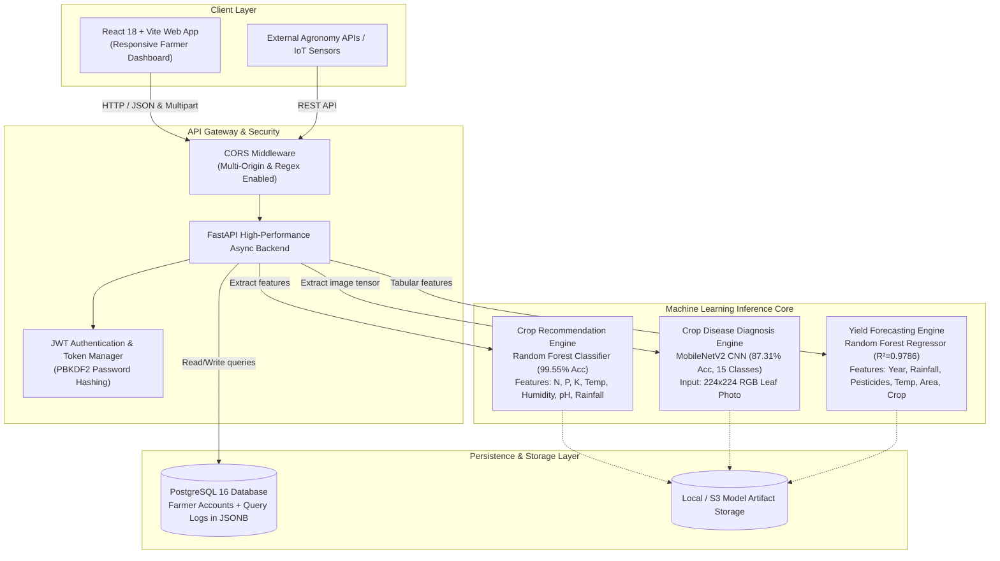

# AgiSense: AI-Driven Crop Detection and Farm Management System

[](https://agrisense-ruddy-three.vercel.app)
[](https://github.com/shibamacademics-ctrl/AgiSense)
[](https://github.com/shibamacademics-ctrl/AgiSense)
[](https://github.com/shibamacademics-ctrl/AgiSense)
[](https://github.com/shibamacademics-ctrl/AgiSense)
[](LICENSE)

> An end-to-end precision agriculture intelligence platform delivering real-time **soil-based crop recommendations**, **leaf disease diagnosis using computer vision**, and **regional harvest yield estimations**. Designed for farmers, agronomists, and agricultural extension services.

---

## 🌐 Live Deployments & Repository Links

- **Repository Branch:** [https://github.com/shibamacademics-ctrl/AgiSense/tree/copy](https://github.com/shibamacademics-ctrl/AgiSense/tree/copy)
- **Production Frontend (Vercel):** [https://agrisense-ruddy-three.vercel.app](https://agrisense-ruddy-three.vercel.app)
- **Interactive API Documentation:** Available at `/docs` (Swagger UI) and `/redoc` (ReDoc).

---

## 📐 System Architecture



---

## 🚀 Core Modules & ML Pipelines

### 1. Soil & Climate-Driven Crop Recommendation
- **Task:** Multi-class classification across 22 major crop species (e.g., Rice, Maize, Chickpea, Cotton, Coffee, Papaya, Apple).
- **Input Features:** Nitrogen (N), Phosphorus (P), Potassium (K), Temperature (°C), Relative Humidity (%), Soil pH, and Rainfall (mm).
- **Selected Algorithm:** **Random Forest Classifier** (100 estimators, tuned leaf split).
- **Inference Output:** Top recommended crop, confidence score, and top-3 ranked viable alternatives.

### 2. Leaf Disease Detection & Pathogen Diagnosis
- **Task:** 15-class computer vision leaf pathogen classification covering Tomato, Potato, and Bell Pepper crops.
- **Input Features:** Leaf imagery resized to $224 \times 224 \times 3$ RGB.
- **Selected Architecture:** **MobileNetV2** transfer learning with ImageNet feature extraction, GlobalAveragePooling2D, and fine-tuned softmax classification head.
- **Inference Output:** Predicted pathogen, diagnostic confidence, automated agronomist treatment action plan, and low-confidence visual alert flags (<60%).

### 3. Crop Yield Prediction
- **Task:** Continuous regression predicting crop harvest output in hectograms per hectare ($hg/ha$) and metric tonnes per hectare ($t/ha$).
- **Input Features:** Calendar Year, Average Annual Rainfall ($mm$), Total Pesticides ($tonnes$), Mean Temperature (°C), Country/Area, and Crop Item.
- **Selected Algorithm:** **Random Forest Regressor** with full categorical pipeline encoding.

### 4. Query Tracking & Persistent Farmer History
- Best-effort persistence into PostgreSQL with JSONB payload indexing.
- Tracks past recommendations, soil health metrics, and pathogen diagnoses over time without blocking model response times.

---

## 📊 Comprehensive Model Evaluation Metrics

All models were evaluated on dedicated hold-out test sets (stratified 80/20 train/test splits).

### Module 1: Crop Recommendation (22 Classes)

| Metric | Random Forest (Champion) | XGBoost Classifier | Baseline Decision Tree |
| :--- | :---: | :---: | :---: |
| **Test Accuracy** | **99.55%** | 99.09% | 96.14% |
| **Macro Precision** | **99.57%** | 99.15% | 96.20% |
| **Macro Recall** | **99.55%** | 99.09% | 96.14% |
| **Macro F1-Score** | **99.55%** | 99.09% | 96.12% |
| **Cross-Validation Score (5-Fold)** | **99.43%** | 98.92% | 95.80% |

*Result summary:* Only 2 minor boundary misclassifications out of 440 test samples (slight overlap between rice and jute under high-rainfall tropical soil conditions).

---

### Module 2: Crop Disease Detection (MobileNetV2 Transfer Learning)

- **Test Sample Size:** 4,122 leaf validation images
- **Overall Test Accuracy:** **87.31%**
- **Macro Average Precision:** **87.99%**
- **Macro Average Recall:** **87.36%**
- **Weighted F1-Score:** **87.29%**

#### Per-Class Performance Breakdown

| Crop & Pathogen Condition | Precision | Recall | F1-Score | Validation Support |
| :--- | :---: | :---: | :---: | :---: |
| **Pepper Bell — Bacterial Spot** | 85.65% | 98.99% | 91.84% | 199 |
| **Pepper Bell — Healthy** | 97.94% | 96.61% | 97.27% | 295 |
| **Potato — Early Blight** | 94.79% | 100.00% | 97.32% | 200 |
| **Potato — Late Blight** | 100.00% | 83.00% | 90.71% | 200 |
| **Potato — Healthy** | 82.35% | 93.33% | 87.50% | 30 |
| **Tomato — Bacterial Spot** | 81.82% | 97.41% | 88.94% | 425 |
| **Tomato — Early Blight** | 81.43% | 57.00% | 67.06% | 200 |
| **Tomato — Late Blight** | 89.32% | 90.03% | 89.67% | 381 |
| **Tomato — Leaf Mold** | 75.55% | 91.05% | 82.58% | 190 |
| **Tomato — Septoria Leaf Spot** | 89.93% | 73.16% | 80.69% | 354 |
| **Tomato — Spider Mites** | 92.24% | 63.88% | 75.49% | 335 |
| **Tomato — Target Spot** | 58.96% | 89.29% | 71.02% | 280 |
| **Tomato — Yellow Leaf Curl Virus** | 99.49% | 90.95% | 95.03% | 641 |
| **Tomato — Mosaic Virus** | 98.51% | 89.19% | 93.62% | 74 |
| **Tomato — Healthy** | 91.92% | 96.54% | 94.17% | 318 |

---

### Module 3: Harvest Yield Prediction (Regression)

| Model Candidate | RMSE ($hg/ha$) ↓ | MAE ($hg/ha$) ↓ | $R^2$ Score ↑ | Selected |
| :--- | :---: | :---: | :---: | :---: |
| **Random Forest Regressor** | **12,449.93** | **6,308.76** | **0.9786** | **Yes (Champion)** |
| **XGBoost Regressor** | 17,996.48 | 11,404.44 | 0.9554 | Baseline |
| **Linear Regression** | 42,144.04 | 29,582.48 | 0.7551 | Baseline |

#### Yield Feature Importance Ranking
1. **Crop Item Type:** 62.10% (primary determinant of baseline genetic yield capacity)
2. **Country / Geographic Area:** 19.77% (regional soil types and farming practices)
3. **Pesticides Used ($tonnes$):** 6.80%
4. **Average Annual Rainfall ($mm$):** 4.23%
5. **Average Temperature (°C):** 4.05%
6. **Year:** 3.05%

---

## 🛠️ Tech Stack

| Layer | Technologies |
| :--- | :--- |
| **Frontend** | React 18, Vite, Lucide Icons, CSS3 Modern Glassmorphism |
| **Backend API** | FastAPI, Starlette, Uvicorn, Pydantic v2 |
| **Machine Learning** | Scikit-Learn, TensorFlow CPU 2.17, MobileNetV2, XGBoost, Pandas, NumPy, Joblib, Pillow |
| **Database & Auth** | PostgreSQL 16, SQLAlchemy 2.0, Psycopg 3, PBKDF2 Password Hashing, JWT (HS256) |
| **DevOps & Cloud** | Docker, Docker Compose, Render, Railway, Vercel, Netlify |

---

## ⚡ Quickstart & Local Setup

### Prerequisites
- Python 3.10 or 3.11
- Node.js 18+ and npm
- (Optional) Docker and Docker Compose

### Option A: Run with Docker Compose (Full Stack with PostgreSQL)

```bash
# Clone the repository and checkout branch copy
git clone -b copy https://github.com/shibamacademics-ctrl/AgiSense.git
cd AgiSense

# Start backend, frontend, and PostgreSQL services
docker compose up --build
```
- Frontend UI: `http://localhost:3000`
- FastAPI Backend: `http://localhost:8000`
- Interactive API Docs: `http://localhost:8000/docs`

---

### Option B: Run Locally Without Docker

#### 1. Setup Backend
```bash
# Create and activate Python virtual environment
python -m venv venv
source venv/bin/activate  # On Windows: .\venv\Scripts\activate

# Install requirements
pip install -r requirements.txt

# Start FastAPI server
uvicorn app.main:app --reload --port 8000 --app-dir Backend
```

#### 2. Setup Frontend
```bash
cd Frontend
npm install
npm run dev
```
Open `http://localhost:5173` in your browser.

---

## ☁️ Deployment Instructions

### 1. Deploy Unified Container to Render (1-Click Blueprint)

1. Push or fork this repository (`https://github.com/shibamacademics-ctrl/AgiSense/tree/copy`).
2. Log into [Render Dashboard](https://dashboard.render.com).
3. Click **New +** $\rightarrow$ **Blueprint**.
4. Connect this repository and select the `copy` branch.
5. Render reads `render.yaml` automatically:
   - Sets up Docker web service building `./Dockerfile` (Unified Frontend + Backend).
   - Provisions a free managed PostgreSQL instance.
   - Sets healthcheck to `/health`.
6. Click **Apply** to launch the live application!

### 2. Deploy Backend on Railway

1. Log into [Railway.app](https://railway.app).
2. Click **New Project** $\rightarrow$ **Deploy from GitHub repo**.
3. Select `shibamacademics-ctrl/AgiSense` and branch `copy`.
4. Railway will auto-detect the root `Dockerfile` and `railway.json`.
5. Add an optional PostgreSQL plugin in Railway to automatically provide `DATABASE_URL`.
6. Copy the generated Railway public URL (e.g., `https://agisense-production.up.railway.app`).

### 3. Deploy Frontend on Vercel

1. Log into [Vercel](https://vercel.com).
2. Click **Add New** $\rightarrow$ **Project** and select `shibamacademics-ctrl/AgiSense` (branch `copy`).
3. Set **Framework Preset** to **Vite**.
4. Set **Root Directory** to `Frontend`.
5. Add Environment Variable:
   - `VITE_API_URL`: Your deployed backend URL (e.g., `https://agisense-production.up.railway.app` or Render URL).
6. Click **Deploy**.

### 4. Deploy Frontend on Netlify

1. Log into [Netlify](https://netlify.com) $\rightarrow$ **Add new site** $\rightarrow$ **Import an existing project**.
2. Select GitHub repo `shibamacademics-ctrl/AgiSense`, branch `copy`.
3. Netlify automatically reads `netlify.toml` (`base: Frontend`, `publish: dist`).
4. Set Environment Variable `VITE_API_URL` to your backend URL.
5. Click **Deploy Site**.

---

## ⚠️ Known Limitations & Future Improvements

### Current Limitations
1. **Lab vs. Field Leaf Photography:**
   - Training images from PlantVillage were collected primarily against uniform background paper. Real-world field images with harsh sunlight, shadows, or multiple overlapping leaves may yield lower confidence.
   - *Mitigation implemented:* Visual low-confidence warnings (<60%) prompt farmers to take closer, well-lit photos.
2. **Cold Start Latency on Free Cloud Tiers:**
   - Free tiers on Render/Railway sleep after 15 minutes of inactivity. Initial startup requires 30–50 seconds to boot the container and trace TensorFlow graph layers.
3. **Historical Macro-Yield Scope:**
   - The yield prediction model operates on country-level historical FAO aggregates. Micro-climate field variations (e.g. drip irrigation, exact sowing date) are not captured in the current feature set.

### Planned Enhancements
- **On-Device Edge Inference (TensorFlow Lite / ONNX Runtime):** Convert MobileNetV2 to TFLite (quantized INT8) for offline leaf diagnosis on low-cost smartphones without internet connectivity.
- **Satellite & Weather API Integration:** Live real-time precipitation and temperature feeds via Open-Meteo / NASA POWER APIs to auto-populate soil and weather parameters.
- **Multilingual Voice Interface:** Add speech-to-text input in regional languages (Hindi, Bengali, Spanish, Swahili) for accessible rural adoption.
- **Real-Time Mandi / Market Prices:** Link crop recommendations with nearby market commodity prices to calculate economic expected ROI.

---

## 👥 Contributors & Contact

- **Author:** Shibam ([@shibamacademics-ctrl](https://github.com/shibamacademics-ctrl))
- **Project Repo:** [https://github.com/shibamacademics-ctrl/AgiSense](https://github.com/shibamacademics-ctrl/AgiSense)

